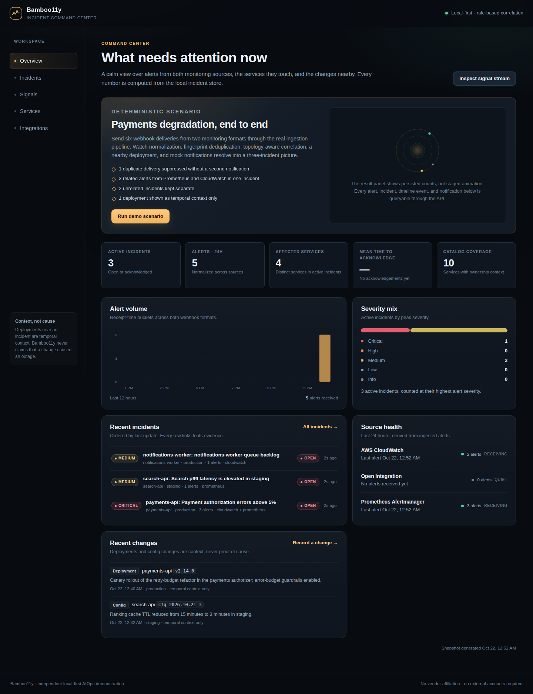
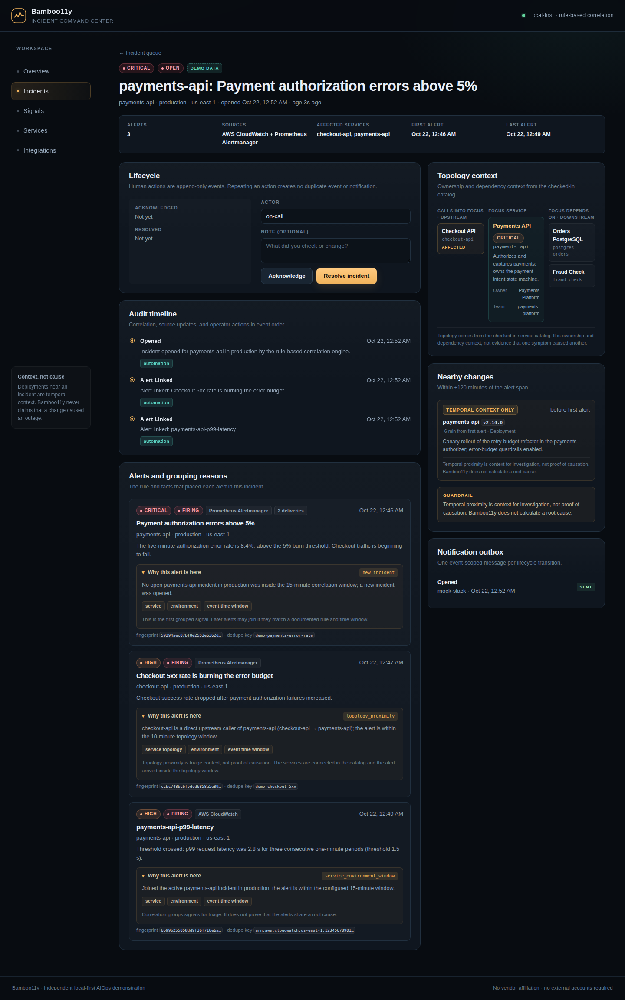
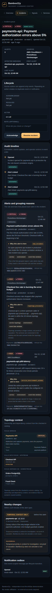
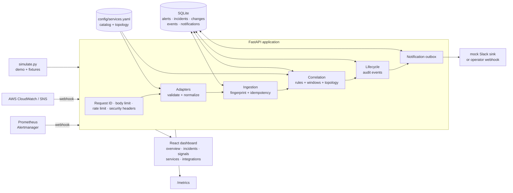

<p align="center">
  
</p>

<h1 align="center">Bamboo11y</h1>

<p align="center">
  <strong>A local-first incident command center that shows its reasoning.</strong><br />
  Two webhook formats in. Deterministic correlation, topology context, and an auditable
  incident out.
</p>

<p align="center">
  <a href="https://github.com/NullLabTests/bamboo11y/actions/workflows/ci.yml"></a>
  
  
  
</p>

> **Context, not cause.** Bamboo11y puts deployments and config changes *next to* an
> incident. It never claims they caused it.

Bamboo11y is an independent, runnable portfolio project. It is not affiliated with,
endorsed by, or a reproduction of any commercial incident-management product. Everything
runs on your machine with SQLite, Python, and Node; no accounts, cloud services, or
credentials are required.

## Why this exists

Alert correlation demos often stop at “we grouped some alerts.” The hard parts are the
ones an on-call engineer actually feels:

- Why are these two signals in the same incident?
- Is this group still safe when a retry arrives, or when an alert shows up late?
- Which services are affected, and what changed nearby?
- Can I trust the dashboard, or is it showing seeded numbers?
- What happens when the notification sink is down?

Bamboo11y is built around those questions. Every alert carries the exact rule that
grouped it. Every grouping is deterministic and testable. Every dashboard number is derived
from persisted rows. The demo runs through the same adapters, ingestion service, correlation
engine, lifecycle code, and notification outbox as a real webhook.

## What you can do

| Area | Behavior |
|---|---|
| **Ingestion** | Alertmanager, CloudWatch/SNS, and open-integration-style webhooks (credits in [`docs/inspirations.md`](docs/inspirations.md)), schema validation, payload caps, per-source rate limiting, structured errors |
| **Normalization** | One alert model across both sources; severity, service, environment, region, and time normalization |
| **Idempotency** | SHA-256 fingerprint per source and dedupe key; retries update occurrence counts instead of creating duplicates |
| **Correlation** | Rule order with configurable windows, same-service joins, one-hop topology joins, late-arrival handling, reopen on re-fire |
| **Context** | Service catalog, dependency graph, affected services, nearby changes marked `temporal_context_only` |
| **Lifecycle** | Open → acknowledged → resolved, notes and actors, append-only audit events, duplicate actions are no-ops |
| **Notifications** | Durable local outbox with mock-Slack delivery; optional operator-supplied webhook; event-scoped dedupe keys |
| **Dashboard** | Overview, incident queue and detail, signal stream, service explorer, integrations, empty/loading/error states |
| **Operations** | JSON logs with request IDs, `/healthz`, `/readyz`, Prometheus metrics, security headers, non-root container |
| **Demo** | One click or one command; deterministic and isolated from live data via an `is_demo` partition |

## A look inside



The overview is derived from the same SQLite rows used by the API. The demo panel reports
persisted counts, not a staged animation.



The incident detail is the heart of the product: lifecycle actions, an append-only audit
timeline, the exact rule and facts that grouped each alert, one-hop topology context, nearby
changes labeled `temporal_context_only`, and the notification outbox.

<p align="center">
  
  <br />
  <sub>Responsive incident detail at a 390 px viewport.</sub>
</p>

## Architecture



**Ingestion path in one sentence:** validate the source payload → normalize it into the
shared alert contract → enrich from the YAML catalog → fingerprint it → apply the four
correlation rules → record lifecycle/audit rows → enqueue and dispatch a notification.

The full component, data-flow, and failure-mode design is in
[`docs/architecture.md`](docs/architecture.md). The decision records are in
[`docs/adr/`](docs/adr/):

- [ADR-0001 — Stack and runtime shape](docs/adr/0001-stack.md)
- [ADR-0002 — Deterministic correlation and idempotency](docs/adr/0002-correlation-and-idempotency.md)
- [ADR-0003 — Persistence, delivery, and scale path](docs/adr/0003-persistence-and-scaling.md)

## Try it locally

### Prerequisites

- Python 3.12+ and `make`
- Node.js 20.19+ or 22.12+ (Node 22 is used in CI)
- Docker is optional; Compose assets are included but were not executable in the
  authoring environment (no Docker daemon).

### Fast path

```bash
git clone https://github.com/NullLabTests/bamboo11y.git
cd bamboo11y
make setup     # .venv, Python deps, npm deps, git hooks
make run       # production build, then API + dashboard on http://127.0.0.1:8000
```

Open <http://127.0.0.1:8000> and select **Run demo scenario**. The primary incident
appears with its rule explanations, topology, and nearby change.

For hot reload while developing:

```bash
make dev       # API on :8000 and Vite on :5173
```

The API stores data in `data/bamboo11y.db` by default. Use a separate database for each
experiment:

```bash
BAMBOO11Y_DATABASE_URL=sqlite:///./data/experiment.db make run
```

### Try the webhook path without the UI

```bash
make demo
```

Expected output (the run ID and incident IDs vary):

```text
HTTP 201 · scenario payments_degradation · run 1a2b3c4d5e6f
  6 received · 5 unique · 1 duplicate · 3 notification(s)
  primary incident: 1
  primary alerts: 3 across cloudwatch, prometheus
  nearby change: payments-api v2.14.0 6.0 min before first alert (temporal_context_only)
  unrelated incidents preserved: 2
    #1 critical payments-api         3 alert(s) ['cloudwatch', 'prometheus']
    #2 medium   search-api          1 alert(s) ['prometheus']
    #3 medium   notifications-worker 1 alert(s) ['cloudwatch']
  disclaimer: The deployment is shown as temporal context only; this scenario does not
  prove that it caused the incident.
```

The server must be running for `make demo`. To send your own traffic:

```bash
python scripts/simulate.py prometheus --dry-run          # inspect a fixture
python scripts/simulate.py prometheus                    # send two related alerts
python scripts/simulate.py prometheus --status resolved   # resolve them
python scripts/simulate.py cloudwatch --state ALARM
python scripts/simulate.py cloudwatch --state OK
python scripts/simulate.py prometheus --repeat 3         # prove idempotency
python scripts/simulate.py reset                         # demo partition only
```

`simulate.py` uses only the Python standard library and the public webhook endpoints. It
does not touch the demo partition.

### Docker Compose

```bash
make docker-up      # dashboard on http://127.0.0.1:8000
make docker-down
```

Optional local Prometheus and Alertmanager, wired back into Bamboo11y's webhook endpoint:

```bash
docker compose --profile observability up -d
# Prometheus:   http://127.0.0.1:9090
# Alertmanager: http://127.0.0.1:9093
```

The container runs as a non-root user with a read-only root filesystem, a persistent
`/data` volume, and a health check. **CI builds the image and smoke-tests `/readyz`** on every
push; Compose itself has not been executed locally, because Docker was unavailable in the
authoring environment. See [`docs/operations.md`](docs/operations.md) for the unverified-paths note.

## The demo scenario

`payments_degradation` is a contract, not a screenshot. It is asserted in
[`backend/tests/test_demo_e2e.py`](backend/tests/test_demo_e2e.py) and documented in
[`docs/spec.md`](docs/spec.md).

1. A canary deployment of `payments-api v2.14.0` is recorded 12 minutes before the alert burst.
2. Three Alertmanager alerts arrive: payments (`production`), checkout (`production`), and
   search (`staging`).
3. Two CloudWatch alarms arrive: payments latency (`production`) and a notifications-worker
   backlog (`production`).
4. The first payment delivery is replayed to exercise idempotency.
5. Correlation produces **three incidents**:
   - **primary:** payments + checkout, 3 alerts, 2 sources, joined by same-service and
     one-hop topology rules;
   - search in staging: unrelated, kept separate;
   - notifications-worker: unrelated, kept separate.
6. The nearby deployment is displayed as temporal context with a 6.0-minute offset. No
   causal claim is stored or rendered.

The demo writes only `is_demo=true` rows and correlation never crosses the demo/live
partition. **Reset demo data** removes only the demo partition.

## How correlation works

For each normalized alert, the engine considers non-resolved incidents in the same
demo/live partition and environment, then applies rules in order:

| Order | Rule | Window | Result |
|---|---|---|---|
| 1 | Existing fingerprint | — | Update the existing alert and linked incident; never duplicate |
| 2 | Same service + environment | `CORRELATION_WINDOW_MINUTES` (15) | Join the most recent open/acknowledged incident |
| 3 | One-hop topology neighbor | `TOPOLOGY_WINDOW_MINUTES` (10) | Join when the alert service directly depends on or is depended on by the incident's primary service |
| 4 | Otherwise | — | Open a new incident |

The stored `correlation` object contains the rule, a human-readable summary, matched facts,
and the incident ID. Topology reasons include a non-causality note. Late alerts use event
time for window checks, so a delayed delivery can still join; future-skewed timestamps are
clamped and surfaced in metadata. A source-resolved alert does not silently resolve a
human-owned incident. If the same fingerprint fires again after resolution, the incident
reopens with an audit event.

No model, embedding, similarity threshold, or probabilistic score is involved. The approach
is deliberately rule-based and inspectable.

## API

| Method | Path | Purpose |
|---|---|---|
| `GET` | `/api/health` | Dashboard-facing health summary |
| `GET` | `/healthz` | Liveness probe |
| `GET` | `/readyz` | Database + catalog readiness probe |
| `POST` | `/api/webhooks/alerts/{source}` | Ingest `prometheus`, `cloudwatch`, or `open-integration` |
| `GET` | `/api/overview` | Aggregated dashboard metrics |
| `GET` | `/api/incidents` | Filtered incident summaries |
| `GET` | `/api/incidents/{id}` | Incident, alerts, timeline, topology, changes, outbox |
| `PATCH` | `/api/incidents/{id}/status` | Acknowledge or resolve with actor/note |
| `GET` | `/api/alerts` | Normalized signal stream |
| `GET` | `/api/alerts/{id}` | Single alert |
| `GET` | `/api/services` | Catalog + dependency edges |
| `GET` | `/api/services/{id}` | Service context, relationships, changes |
| `GET` | `/api/changes` | Recorded change events |
| `POST` | `/api/changes` | Record a deployment/config/rollback/flag change |
| `GET` | `/api/integrations` | Source health, limits, notification state |
| `GET` | `/api/notifications` | Notification outbox |
| `POST` | `/api/notifications/dispatch` | Retry pending/failed deliveries |
| `POST` | `/api/mock/slack` | Local receiver for the optional HTTP sink |
| `POST` | `/api/demo/run` | Run the deterministic scenario |
| `POST` | `/api/demo/reset` | Reset the demo partition |
| `GET` | `/metrics` | Prometheus text exposition |

Interactive OpenAPI docs are at <http://127.0.0.1:8000/docs> while the API is running.
Requests accept an optional `X-Bamboo11y-Delivery-Id` (or `Idempotency-Key`) header; it is
stored as metadata and does not replace fingerprint idempotency.

### Alertmanager example

```bash
curl -sS -X POST http://127.0.0.1:8000/api/webhooks/alerts/prometheus \
  -H 'Content-Type: application/json' \
  -H 'X-Bamboo11y-Delivery-Id: demo-001' \
  -d '{
    "version": "4",
    "status": "firing",
    "receiver": "bamboo11y",
    "alerts": [{
      "status": "firing",
      "fingerprint": "payments-high-errors",
      "labels": {
        "alertname": "PaymentsAPIHighErrorRate",
        "service": "payments-api",
        "environment": "production",
        "severity": "critical",
        "region": "us-east-1"
      },
      "annotations": {
        "summary": "Payment authorization errors above 5%",
        "description": "The five-minute error rate is 8.4%."
      },
      "startsAt": "2026-10-21T11:54:00Z"
    }]
  }'
```

### CloudWatch/SNS example

```bash
curl -sS -X POST http://127.0.0.1:8000/api/webhooks/alerts/cloudwatch \
  -H 'Content-Type: application/json' \
  -d '{
    "Type": "Notification",
    "MessageId": "local-001",
    "TopicArn": "arn:aws:sns:us-east-1:123456789012:bamboo11y-local",
    "Subject": "ALARM: payments-api-p99-latency",
    "Timestamp": "2026-10-21T11:57:00Z",
    "Message": "{\"AlarmName\":\"payments-api-p99-latency\",\"AlarmArn\":\"arn:aws:cloudwatch:us-east-1:123456789012:alarm:payments-api-p99-latency\",\"NewStateValue\":\"ALARM\",\"NewStateReason\":\"p99 latency was 2.8 s for three periods.\",\"StateChangeTime\":\"2026-10-21T11:57:00Z\",\"Region\":\"us-east-1\",\"Severity\":\"high\",\"Dimensions\":[{\"Name\":\"Service\",\"Value\":\"payments-api\"},{\"Name\":\"Environment\",\"Value\":\"production\"}]}"
  }'
```

A cloudwatch alarm can also be posted directly without the SNS envelope. See
`backend/app/adapters/cloudwatch.py` and the fixtures in `backend/tests/fixtures.py`.

### Open-integration example (vendor-neutral)

Any monitoring system that can POST JSON can use the open-integration contract:

```bash
curl -sS -X POST http://127.0.0.1:8000/api/webhooks/alerts/open-integration \
  -H 'Content-Type: application/json' \
  -d '{
    "app": "checkout",
    "check": "sessions-pool",
    "status": "critical",
    "subject": "Session pool saturated",
    "description": "Active sessions at 100% of the configured cap.",
    "tags": {"service": "checkout-api", "environment": "production"}
  }'
```

Status semantics: `critical` → firing/critical, `warning` → firing/medium,
`acknowledged` → firing/high, `ok` → resolved/info. `app` + `check` is the
deduplication key. The contract follows the vendor-neutral pattern documented by
BigPanda as an **Open Integration Manager** — used as ideas only, with our own wire
format. See [`docs/inspirations.md`](docs/inspirations.md) for the full credit and the
non-affiliation note; Bamboo11y is not affiliated with BigPanda.

## Configuration

Copy [`.env.example`](.env.example) to `.env` or inject the same names through your
environment/container. All settings use the `BAMBOO11Y_` prefix.

| Setting | Default | Notes |
|---|---|---|
| `BAMBOO11Y_DATABASE_URL` | `sqlite:///./data/bamboo11y.db` | SQLite path; parent directory is created |
| `BAMBOO11Y_SERVICE_CATALOG_PATH` | `config/services.yaml` | Validated on startup; restart after edits |
| `BAMBOO11Y_STATIC_DIR` | `frontend/dist` | Built SPA; API-only mode if missing |
| `BAMBOO11Y_CORRELATION_WINDOW_MINUTES` | `15` | Same-service window |
| `BAMBOO11Y_TOPOLOGY_CORRELATION_ENABLED` | `true` | Enable one-hop topology joins |
| `BAMBOO11Y_TOPOLOGY_WINDOW_MINUTES` | `10` | Topology join window |
| `BAMBOO11Y_CHANGE_CONTEXT_WINDOW_MINUTES` | `120` | ± window for nearby changes |
| `BAMBOO11Y_RATE_LIMIT_PER_MINUTE` | `120` | Per source + client, per API process |
| `BAMBOO11Y_MAX_PAYLOAD_BYTES` | `1000000` | Request body cap |
| `BAMBOO11Y_MAX_ALERTS_PER_REQUEST` | `100` | Batch cap |
| `BAMBOO11Y_LOG_JSON` | `true` | Structured request logs |
| `BAMBOO11Y_NOTIFICATION_WEBHOOK_URL` | unset | Optional operator-supplied HTTP sink |

Security headers, request IDs, and body limits are always on. The dashboard is served by the
API when `frontend/dist` exists; otherwise run Vite with `make dev`.

## Quality gates

```bash
make check          # Ruff, Pytest, ESLint, TypeScript, Vitest, build, config validation
make test           # backend + frontend tests
make lint           # Ruff + ESLint + TypeScript
make validate       # catalog, settings, Compose, CI, secret scan
```

The repository currently has **57 backend tests** (normalization for all three sources,
invalid payloads, idempotency, correlation windows, topology, late arrival, lifecycle,
demo contract, open-integration adapter semantics, end-to-end ingestion) and **8 frontend
component tests** (overview, demo, incident queue,
detail actions, integrations, services). CI runs the same commands on Python 3.12 and 3.13,
Node 22, and builds/smoke-tests the container image. The scenario test is the regression
eval for the demo story: if the grouping or numbers drift, CI fails.

## Project layout

```text
backend/
  app/
    adapters/          source-specific validation + normalization
    api/routes/        HTTP surface
    core/              logging, metrics, middleware, rate limiting
    services/          ingestion, correlation, lifecycle, changes, demo, notifications
    models.py          SQLAlchemy schema
    schemas.py         Pydantic API contracts
  tests/               57 deterministic tests with a fixed clock and temp SQLite
config/services.yaml   service catalog and dependency graph
frontend/
  src/api/             typed API client and contracts
  src/pages/           overview, incidents, detail, signals, services, integrations
  src/components/      shell, states, chart, topology, toasts
  test/                Vitest + Testing Library behavior tests
docs/                  spec, architecture, operations, security, demo script, ADRs, SDLC
ops/                   optional Prometheus and Alertmanager configuration
scripts/               simulator, full check, dev runner, config validator
```

## Design principles

- **Explain before asking for trust.** Every grouping has a stored reason and matched facts.
- **Context is not cause.** Changes carry `relationship: temporal_context_only` and visible
  copy; no field is named “root cause.”
- **Deterministic over clever.** Windows and rules can be tested and replayed. There is no
  model to hallucinate a grouping.
- **Demo through the front door.** The demo uses the same ingestion path as external
  webhooks, isolated by an explicit partition.
- **Operate what you ship.** Health, readiness, metrics, logs, request IDs, bounded inputs,
  and a documented production-gap list are part of the product.

## Production gaps

This is a local demonstration, not a production incident platform. It intentionally omits
authentication/authorization, tenant isolation, TLS termination, durable queues and workers,
distributed rate limiting, HA storage, retention/archival, secret management, suppression
windows, escalation policies, ticketing integrations, and formal SLO tracking. ADR-0003 and
[`docs/security.md`](docs/security.md) describe the migration path and threat model. Do not
expose it to the public internet as-is.

Docker Compose and the optional observability profile could not be executed in the
authoring environment because no Docker daemon was available. The Dockerfile and Compose
files are statically validated; CI builds the image and smoke-tests readiness on every push.
Compose orchestration itself has not been executed anywhere. This limitation is called out
rather than hidden.

## AI-native SDLC evidence

The project follows Anthropic's AI-native SDLC playbook and keeps the artifacts, not just
the output:

- [`intent.md`](intent.md) — problem, users, non-goals, success criteria
- [`docs/spec.md`](docs/spec.md) — functional/non-functional contract
- [`docs/implementation-plan.md`](docs/implementation-plan.md) — stage-by-stage checklist
- [`docs/sdlc.md`](docs/sdlc.md) — intent → evidence traceability
- [`.claude/skills/`](.claude/skills/) — repeatable verification and scenario authoring
- [`.github/workflows/ci.yml`](.github/workflows/ci.yml) — executable quality gate

A discovery narrative and five-minute presentation script are in
[`docs/demo-script.md`](docs/demo-script.md).

## License

[MIT](LICENSE) © 2026 Bamboo11y contributors. Independent project; no vendor affiliation.
