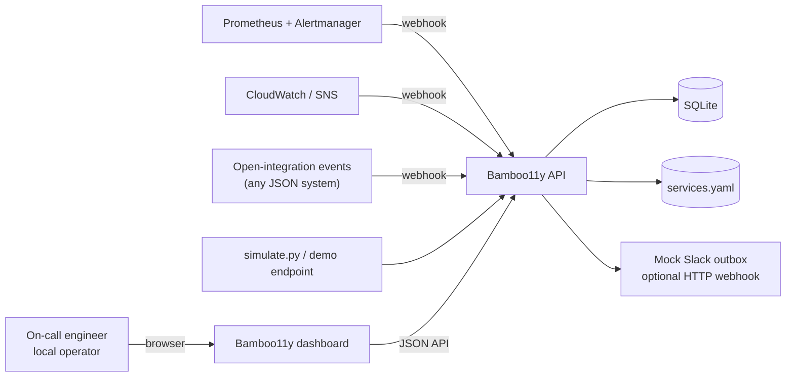
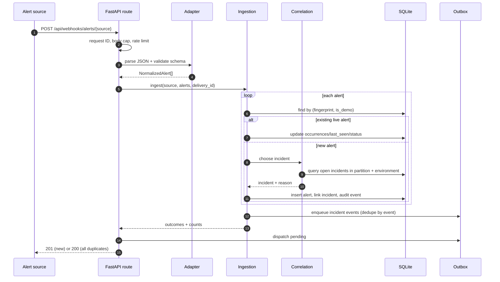
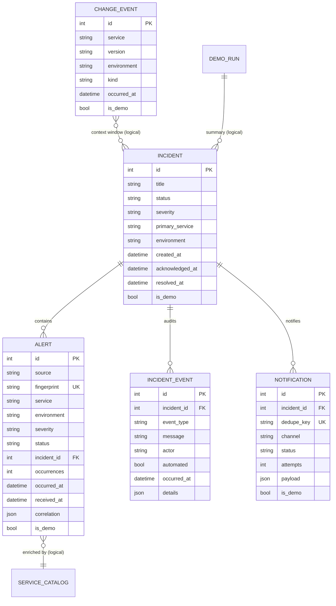
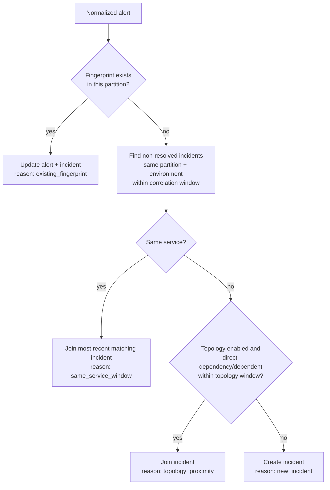
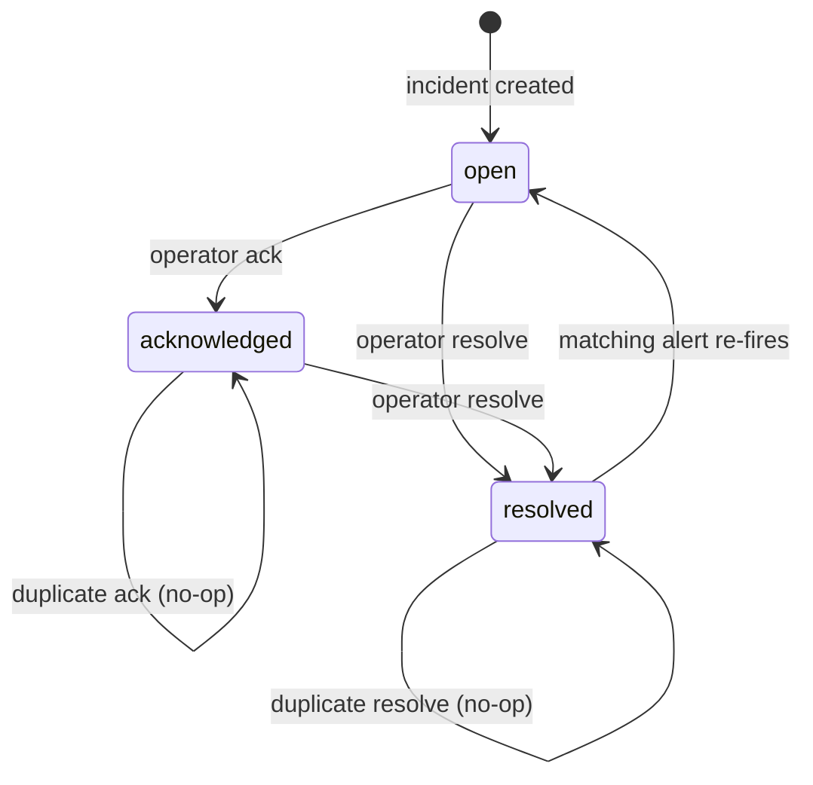

# Bamboo11y architecture

**Audience:** engineers reviewing the design or extending the project.  
**Status:** implemented local-first system. Production gaps are explicit.

## 1. Context



The system is a modular monolith. One Python process serves the JSON API, the built React
SPA, health probes, and Prometheus metrics. SQLite is the only required dependency. This is
deliberate: the interesting design problem is correlation and explainability, not
distributed plumbing. ADR-0001 records the stack choice; ADR-0003 records the scale path.

## 2. Components

| Component | Responsibility | Source |
|---|---|---|
| Adapters | Validate source payloads and map them to the shared alert contract | `backend/app/adapters/` |
| Ingestion | Fingerprint, idempotency, alert persistence, occurrence updates | `backend/app/services/ingestion.py` |
| Enrichment | Catalog lookup, owner/team/tier, topology context | `backend/app/services/enrichment.py` |
| Correlation | Ordered deterministic rules, windows, reasons | `backend/app/services/correlation.py` |
| Lifecycle | Ack/resolve transitions, audit events, reopen semantics | `backend/app/services/incidents.py` |
| Changes | Change records and nearby-change context | `backend/app/services/changes.py` |
| Notifications | Transactional outbox, mock sink, optional webhook, retry | `backend/app/services/notifications.py` |
| Demo | Deterministic scenario through the real pipeline | `backend/app/services/demo.py` |
| Dashboard | Typed API client and workspace UI | `frontend/src/` |
| Runtime | Settings, clock, DB engine, logging, metrics, middleware | `backend/app/config.py`, `clock.py`, `db.py`, `core/` |

The service catalog is the topology source of truth. It is a validated YAML file, loaded at
startup, with unique IDs, known dependency targets, and cycle detection. There is no write
endpoint; changing topology is a reviewed file change plus a process restart.

## 3. Ingestion sequence



A request is transactional. Validation happens before any write, and a rejected payload
creates no partial rows. Notification dispatch happens after the incident commit; a sink
failure leaves a `pending`/`failed` outbox row rather than failing the ingest request.

## 4. Data model



Unique constraints are the safety net for concurrency and retries:

- `alerts(fingerprint, is_demo)` — one alert row per source identity and partition.
- `notifications(dedupe_key)` — event-scoped delivery, never per retry.
- `change_events(external_id)` — idempotent change ingestion.

The `is_demo` partition is applied to alerts, incidents, notifications, changes, and every
correlation query. A demo cannot join or mutate a live incident.

## 5. Correlation decision flow



Important properties:

- **Event time, not receipt time,** drives window comparisons, so late alerts can still
  join. Future timestamps beyond the skew tolerance are clamped for comparison.
- **Only one hop** is considered for topology joins. This prevents a single noisy alert
  from sweeping an entire dependency graph into one incident.
- **Reasons are stored as JSON** on the alert and rendered in the incident detail. The stored
  reason reflects the first grouping decision; later retries do not rewrite history.
- **Severity escalates** to the maximum of linked alerts. Status is human-owned; a source
  resolution updates the alert but does not silently resolve the incident.
- **A re-fire after resolution** reopens the incident with an explicit audit event.

Thresholds are configuration, not constants in the algorithm: same-service window,
topology window, topology enable/disable, and change context window. Tests cover boundaries
inside and outside each window.

## 6. Lifecycle and notifications



Every real transition writes an append-only `incident_events` row. Duplicate actions return
`changed=false` and do not enqueue a notification. A notification dedupe key derives from
the incident and event ID, so retries cannot create a second Slack-style message.

The outbox is intentionally simple: rows are persisted in the same transaction as the
incident change, then dispatched. With the default configuration the sink is a local
mock-Slack record; the UI labels it clearly and never claims a real Slack workspace was
contacted. Setting `BAMBOO11Y_NOTIFICATION_WEBHOOK_URL` exercises a real HTTP receiver,
including a built-in local receiver at `/api/mock/slack`.

## 7. HTTP and error semantics

- Request IDs are accepted only if they match a safe character/length pattern; otherwise a
  new ID is generated. Every response carries `X-Request-ID`.
- Validation errors share a consistent shape: `detail`, machine `code`, optional `errors`,
  `hints`, and `context`. The dashboard renders these instead of a generic failure.
- Body caps are enforced from `Content-Length` and again on the read path. Alert count and
  label cardinality are bounded in the adapters.
- Rate limiting is a per-process sliding window keyed by client + source. A 429 includes
  `Retry-After`, `X-RateLimit-Limit`, and `X-RateLimit-Remaining`. This is explicitly not a
  distributed limiter; see ADR-0003.
- Security headers (CSP, frame denial, nosniff, referrer policy, permissions policy) are
  applied to every response. The Swagger/ReDoc pages have a narrowly scoped CSP exception
  for their CDN assets; the dashboard remains self-only.
- Logs are structured JSON with method, path, status, duration, and request ID. Bodies,
  authorization headers, and query secrets are not logged.

## 8. Frontend composition

```text
App
└── BrowserRouter
    └── ToastProvider
        └── AppShell (skip link, top bar, nav, context note, footer)
            ├── OverviewPage      metrics, volume chart, severity mix, source health,
            │                     recent changes, demo runner
            ├── IncidentsPage     URL-backed filters, pagination, empty/loading/error
            ├── IncidentDetailPage summary, actions, reasons, timeline, topology,
            │                     nearby changes, notifications
            ├── SignalsPage       normalized alert stream
            ├── ServicesPage      catalog explorer + topology + changes
            └── IntegrationsPage  source health, copy controls, outbox, change form
```

The API client is a thin typed wrapper over `fetch`. `useResource` aborts stale requests and
ignores late responses, so filter changes cannot race. Tests mock `fetch` at the boundary
and assert rendered behavior rather than implementation details. There is no global state
library; URL search params own shareable filters.

## 9. Key tradeoffs

| Decision | Benefit | Cost |
|---|---|---|
| Rule-based correlation | Explainable, deterministic, testable | Cannot learn novel groupings |
| One-hop topology | Limits blast radius and over-grouping | Misses transitive relationships by design |
| SQLite | Zero-dependency local demo, easy inspection | Single writer; not HA |
| Modular monolith | Simple startup and debugging | Service boundaries are logical, not deployable |
| Transactional outbox | No lost notifications on sink failure | Dispatch is synchronous unless a worker is added |
| Demo partition | Safe, repeatable portfolio story | Duplicates schema partition logic in queries |
| YAML catalog | Reviewable topology changes | No runtime editing; restart required |

## 10. Where to change what

| Change | Start here | Contract to update |
|---|---|---|
| Add an alert source | `backend/app/adapters/`, `registry.py` | Adapter tests, spec normalization table, README |
| Change correlation | `services/correlation.py` | Correlation tests, spec rule table, architecture flow |
| Change lifecycle | `services/incidents.py` | Lifecycle tests, state diagram |
| Change the demo | `services/demo.py` | `test_demo_e2e.py`, spec, README, frontend fixtures |
| Change topology | `config/services.yaml` | Catalog tests, demo expectations if affected |
| Add a dashboard view | `frontend/src/pages/`, `App.tsx` | Component tests, accessibility states |
| Add a metric | `core/metrics.py` | Operations doc, Prometheus rules |

The full requirements are in [`spec.md`](spec.md); operational procedures are in
[`operations.md`](operations.md); security analysis is in [`security.md`](security.md).
